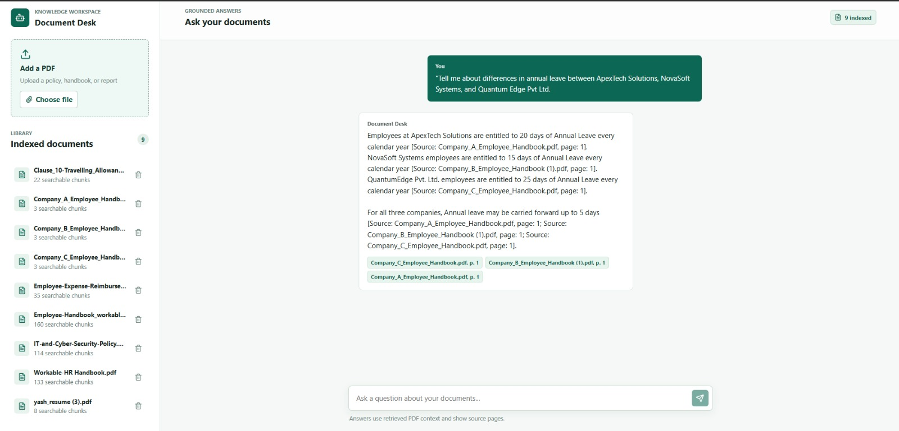
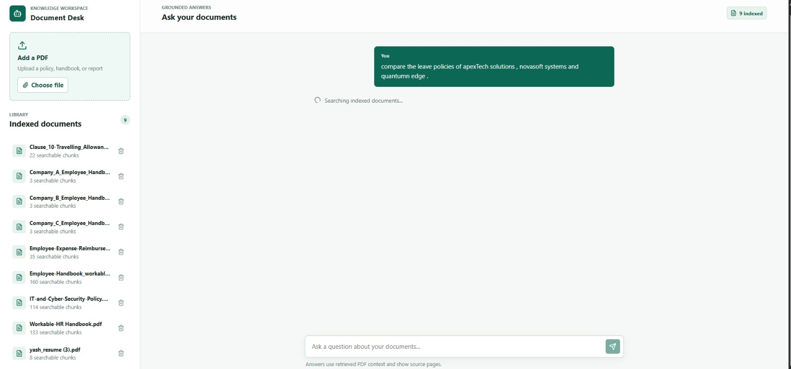

# Document Desk

A full-stack Retrieval-Augmented Generation (RAG) application that lets users
upload PDFs, ask questions about them, and receive grounded answers with
document and page-level citations.

## Features

- Upload and index multiple PDFs
- Page-aware text extraction with PyMuPDF
- Semantic search using Sentence Transformers and ChromaDB
- Gemini-generated answers grounded in retrieved document context
- Source, page, and chunk-level metadata
- Document listing and deletion through FastAPI
- React web interface for upload, chat, and document management

## Architecture

PDF Upload
-> PyMuPDF page extraction
-> Recursive text chunking
-> Sentence Transformer embeddings
-> ChromaDB vector storage
-> Similarity search
-> Gemini response with citations

## Tech Stack

- Python, FastAPI, Uvicorn
- PyMuPDF
- Sentence Transformers
- ChromaDB
- Google Gemini API
- LangSmith
- React
- HTML/CSS

## Setup

1. Clone the repository.
2. Create and activate a virtual environment.
3. Install dependencies:

```bash
pip install -r requirements.txt
```

4. Create a `.env` file from `.env.example` and set your keys:

```bash
GEMINI_API_KEY=your-gemini-api-key
LANGSMITH_TRACING=true
LANGSMITH_API_KEY=your-langsmith-api-key
LANGSMITH_PROJECT=rag-pdf-app
```

LangSmith tracing is optional. When enabled, each chat request records the
question, retrieved ChromaDB chunks, source metadata, final prompt, and Gemini
answer. Upload ingestion is also traced so you can check whether a PDF was
extracted, chunked, embedded, and indexed successfully.

## API Endpoints

| Method | Endpoint           | Purpose                           |
|--------|--------------------|-----------------------------------|
| POST   | `/chat`            | Ask a question about indexed PDFs |
| POST   | `/upload`          | Upload and index a PDF            |
| GET    | `/documents`       | List indexed documents            |
| DELETE | `/delete/{pdf_id}` | Delete a document and its vectors |


## Screenshots

### Home Page


### Chat Interface


.jpeg)

### Retrieved Context


