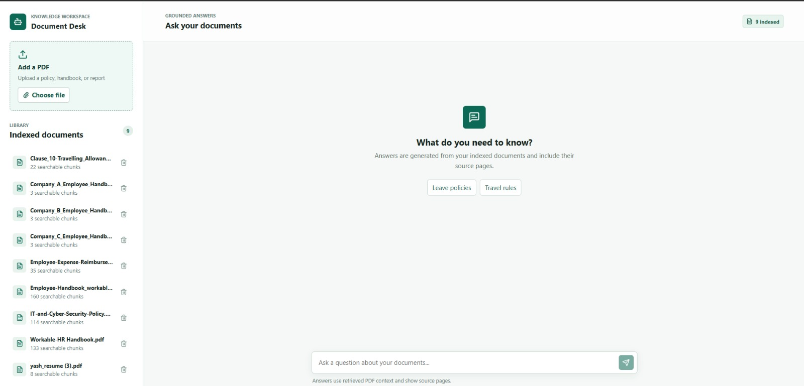

# Document Desk - Self-Evaluating PDF RAG

Document Desk is a full-stack Retrieval-Augmented Generation (RAG) application
for asking questions about uploaded PDF documents. It returns page-level
citations and uses a bounded evaluation-and-repair loop to avoid presenting
answers that cannot be supported by the uploaded documents.

The project deliberately favours a safe abstention over a convincing but
unsupported answer.

## Features

- Upload, index, list, and delete multiple PDF documents.
- Extract text page by page, retaining document, page, and chunk metadata.
- Create semantic embeddings and search document content by meaning rather than
  exact keyword match.
- Generate concise answers with source and page citations.
- Retrieve a wider candidate set, then use an LLM to select only chunks that
  contain direct evidence for the question.
- Grade a generated answer for groundedness, relevance, completeness, and
  citation validity before showing it to the user.
- Run one bounded self-healing attempt: rewrite the retrieval query, search
  again, and re-evaluate.
- Fail closed: return a fixed safe abstention if there is insufficient evidence
  or an evaluation call fails.
- Show a verified/unverified status and confidence score in the chat UI.
- Trace ingestion and question-answering stages with LangSmith when enabled.
- Include unit tests for verified answers, safe abstention, and evaluator JSON
  parsing.

## How It Works

```text
PDF upload
  -> page-aware text extraction
  -> overlapping text chunks
  -> Sentence Transformer embeddings
  -> persistent ChromaDB vector index

Question
  -> retrieve 8 candidate chunks
  -> strict retrieval evaluation and selection (up to 4 chunks)
  -> Gemini answer generation using selected context only
  -> strict answer evaluation
  -> verified answer with citations
     OR
  -> query rewrite + one retry
     OR
  -> safe abstention
```

### Self-evaluation criteria

Every generated answer is checked against the supplied chunks:

| Criterion | Meaning |
|---|---|
| Groundedness | Each factual claim must be explicitly supported by the PDF context. |
| Relevance | The response must answer the user’s actual question. |
| Completeness | The selected context must adequately cover the requested answer. |
| Citation validity | The cited source and page must correspond to supplied context. |
| Abstention decision | The evaluator may reject an answer even if it sounds plausible. |

The default minimum scores are configured in `app/config.py`:

| Setting | Default | Purpose |
|---|---:|---|
| `TOP_K` | 8 | Candidate chunks retrieved initially. |
| `ANSWER_CONTEXT_K` | 4 | Maximum chunks supplied to final answer generation. |
| `MAX_REPAIR_ATTEMPTS` | 1 | Maximum automatic recovery retries. |
| `MIN_GROUNDEDNESS_SCORE` | 0.85 | Minimum evidence-support score. |
| `MIN_ANSWER_RELEVANCE_SCORE` | 0.75 | Minimum question-answer relevance score. |
| `MIN_COMPLETENESS_SCORE` | 0.70 | Minimum coverage score. |

## Safe-Answer Behaviour

The application does not expose a normal AI answer when:

- no indexed chunks match the question;
- the retrieval evaluator says the text does not contain enough evidence;
- the generated answer includes unsupported claims;
- citations are judged invalid;
- any required score is below its configured threshold;
- an evaluator response is invalid or unavailable; or
- the one permitted repair attempt also fails.

In those cases, it responds with:

```text
I couldn't verify an answer from the uploaded documents.
```

This is a **fail-closed** design. An evaluator failure is treated as lack of
verification, not as permission to return the generated text.

## Technology Choices and Rationale

| Tool | Why it is used here | Advantage for this project | Alternative considered and trade-off |
|---|---|---|---|
| Python | Backend and ML ecosystem language. | Mature libraries for PDF extraction, embeddings, FastAPI, and LLM integrations. | Node.js can serve APIs well, but Python provides a more direct ecosystem for local embedding and document-processing work. |
| FastAPI | HTTP API for chat and file uploads. | Type-friendly request validation, async-friendly endpoints, automatic OpenAPI documentation, and simple integration with Python services. | Flask is simpler for small APIs but has fewer built-in validation and async ergonomics; Django is more comprehensive than this focused API requires. |
| Uvicorn | ASGI application server. | Lightweight, fast local server designed for FastAPI/ASGI apps. | Gunicorn is commonly used in production but normally hosts Uvicorn workers; it is unnecessary for local development. |
| PyMuPDF | PDF text extraction. | Fast extraction with page-level access, which makes page citations possible. | PyPDF2/pypdf are useful basic readers but can be less robust or less convenient for page-aware extraction. OCR tools solve scanned PDFs but add complexity and are not currently included. |
| LangChain RecursiveCharacterTextSplitter | Chunking extracted document text. | Overlapping chunks preserve context across boundaries and work well with retrieval. | Fixed character slicing can split sentences abruptly; semantic chunking can be better but costs more compute and adds complexity. |
| Sentence Transformers `all-MiniLM-L6-v2` | Local embedding generation. | Fast, free after download, privacy-friendly, and suitable for a lightweight semantic-search prototype. | Hosted embeddings may provide stronger retrieval quality but introduce per-request cost, external dependency, and data-sharing concerns. Larger local models improve quality but require more RAM and CPU/GPU resources. |
| ChromaDB | Persistent local vector database. | Simple API, local persistence in `chromaDB/`, and no separate database server needed. | FAISS is very fast but needs more custom metadata/persistence handling. Pinecone, Weaviate Cloud, or Qdrant Cloud scale further but require external infrastructure and potentially incur cost. |
| Google Gemini | Answer generation, retrieval grading, answer grading, and query rewriting. | One API supports natural-language generation and structured JSON evaluation, keeping the implementation compact. | Separate models for generation and judging can reduce shared-model bias, but add operational complexity and cost. Local LLMs offer privacy but typically require stronger hardware and more setup. |
| LangSmith | Optional traces for the pipeline. | Lets developers inspect retrieved chunks, prompts, evaluator decisions, retries, and final outputs. | Plain application logs are simpler and fully local, but are less useful for tracing nested LLM/RAG steps. |
| React + HTM | Browser chat interface. | React offers component/state management; HTM avoids a separate JSX build setup for this small application. | Vanilla JavaScript has fewer dependencies but becomes harder to maintain as UI state grows. A full Vite/Next.js build provides more tooling but adds setup overhead. |
| HTML/CSS | Layout and visual design. | Keeps the frontend lightweight and transparent. | Component libraries accelerate large interfaces but can add significant bundle size and styling constraints. |
| `unittest` | Automated checks. | Included with Python, so tests run without another test framework dependency. | pytest has a richer developer experience and plugin ecosystem, but adds an additional dependency for the current small test suite. |

## Repository Structure

```text
app/
  api.py               FastAPI routes and application startup
  rag.py               Main self-evaluating RAG orchestration
  evaluation.py        JSON parsing and evaluator/query-rewrite prompts
  ingest_pipeline.py   PDF ingestion and indexing orchestration
  ingest.py             Page-aware PDF text extraction
  chunking.py           Overlapping text chunk creation
  embeddings.py         Sentence Transformer embedding service
  vectordb.py           ChromaDB persistence, search, and deletion
  prompt.py             Grounded answer prompt
  config.py             Paths, model, retrieval, and threshold settings
  tracing.py            Optional LangSmith tracing helpers
frontend/
  index.html            Browser entry point
  app.jsx               React/HTM chat and document-management UI
  styles.css            UI styling
data/pdf/               Uploaded PDFs (created at runtime)
chromaDB/               Persistent vector database (created/populated at runtime)
tests/                  Unit tests for safety-critical flow
```

## Setup

### Prerequisites

- Python 3.10 or newer
- A Google Gemini API key
- Internet access for Gemini calls and the initial embedding-model download

### Install

From the project root:

```powershell
..venv\Scripts\Activate.ps1
pip install -r requirements.txt
```

If you do not already have a virtual environment:

```powershell
python -m venv .venv
..venv\Scripts\Activate.ps1
pip install -r requirements.txt
```

Create `.env` from `.env.example` and add your credentials:

```env
GEMINI_API_KEY=your-gemini-api-key

# Optional LangSmith tracing
LANGSMITH_TRACING=true
LANGSMITH_API_KEY=your-langsmith-api-key
LANGSMITH_PROJECT=rag-pdf-app
```

Do not commit `.env`; it contains credentials.

## Run the Application

From the repository root, run:

```powershell
..venv\Scripts\python.exe -m uvicorn api:app --reload --app-dir app
```

Then visit:

```text
http://127.0.0.1:8000
```

`--app-dir app` is important because the backend modules use imports such as
`from config import ...`; it tells Uvicorn where `api.py` and its sibling
modules live.

## API

| Method | Endpoint | Purpose |
|---|---|---|
| `POST` | `/upload` | Upload and index one PDF. |
| `POST` | `/chat` | Ask a question about indexed documents. |
| `GET` | `/documents` | List indexed documents and chunk counts. |
| `DELETE` | `/delete/{pdf_id}` | Remove a document’s vectors and stored PDF. |

### Example chat request

```json
POST /chat
{
  "question": "How many annual leave days are available?"
}
```

A verified response includes:

```json
{
  "answer": "Employees receive 12 annual leave days. [Source: policy.pdf, page: 3]",
  "sources": [{"source": "policy.pdf", "page": 3}],
  "evaluation": {
    "verified": true,
    "confidence": 0.95,
    "attempts": 1
  }
}
```

## Testing

Run the safety-focused unit tests:

```powershell
..venv\Scripts\python.exe -m unittest discover -s tests -v
```

The tests cover evaluator JSON parsing, successful verified-answer flow, and
safe abstention after failed retrieval/repair.

## Limitations

- **LLM-as-a-judge is not a proof of truth.** Gemini generates and evaluates
  responses, so the evaluator can still make mistakes or share the generator’s
  blind spots.
- **PDF extraction is text-based.** Scanned/image-only PDFs need OCR, which is
  not currently implemented. Complex layouts, tables, and multi-column pages
  may extract imperfectly.
- **No authentication or multi-user isolation.** This is designed as a local
  prototype, not a production multi-tenant system.
- **Local persistent storage.** PDFs and Chroma vectors live on the machine;
  there is no backup, access policy, encryption-at-rest configuration, or
  cloud synchronization layer.
- **Retrieval quality depends on document quality.** Missing text, poor OCR,
  vague questions, chunk boundaries, and embedding limitations can prevent
  useful chunks from being found.
- **No lexical/hybrid retrieval or reranker.** Retrieval is semantic-vector
  search only. Exact identifiers, part numbers, and rare terms may benefit
  from BM25/hybrid search and a cross-encoder reranker.
- **Evaluation adds latency and API cost.** A normal successful request makes
  retrieval-grade, answer-generation, and answer-grade Gemini calls. A failed
  first attempt also uses a rewrite and a second sequence of calls.
- **Fixed thresholds require calibration.** Current score thresholds are
  reasonable starting points, not universally correct values. They should be
  tuned using real document questions and expected answers.
- **One retry only.** This intentionally bounds cost and latency, but cannot
  repair every difficult retrieval issue.
- **Citation validation is evaluator-based.** The app passes page/source data
  to the evaluator, but does not yet perform a deterministic claim-to-span
  citation check.
- **No persistent evaluation analytics.** LangSmith can trace runs when
  enabled, but the application does not yet store user feedback or aggregate
  quality metrics locally.

## Recommended Next Improvements

- Add OCR for scanned PDFs.
- Add hybrid retrieval (BM25 + semantic vectors) and a cross-encoder reranker.
- Use a separate model for generation and grading to reduce shared-model bias.
- Add document selection/filtering in the UI.
- Add answer feedback buttons and store feedback/evaluation results.
- Create a benchmark dataset and track Recall@K, MRR, groundedness, and
  abstention accuracy.
- Add authentication, document access control, rate limits, and secure cloud
  storage before deploying for multiple users.
- Move environment-specific thresholds into environment variables or an admin
  configuration screen.

## Screenshots

### Home Page



### Chat Interface


.jpeg)

### Retrieved Context


